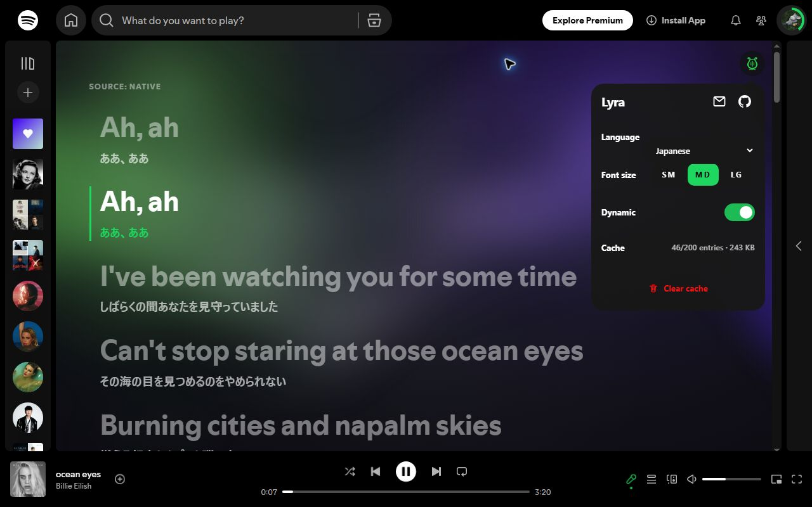
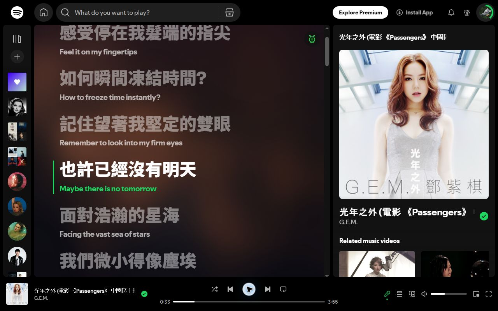
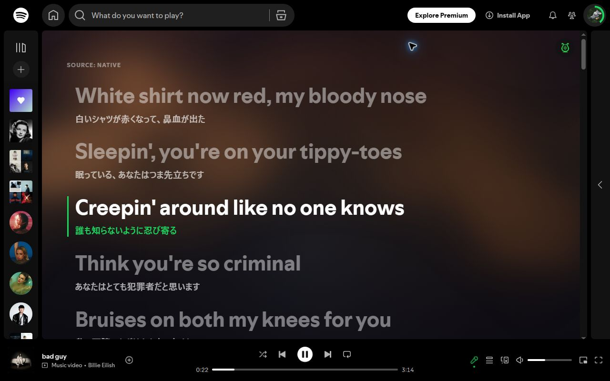
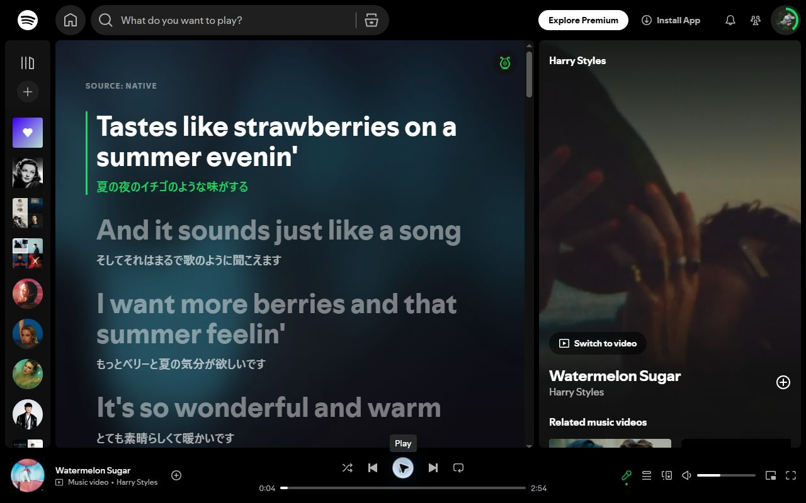

<p align="center">
  
</p>

<h1 align="center">Lyra</h1>

<p align="center">
  Bilingual, synchronized lyrics for Spotify Web Player.
</p>

<p align="center">
  <a href="https://chromewebstore.google.com/detail/lyra/niidbfopdffpahbgohhgbiiimpmpdodn?hl=en-US&amp;utm_source=ext_sidebar"></a>
  <a href="LICENSE"></a>
  
  
  
</p>

Lyra is an open-source Chromium extension that adds original and translated
lyrics to Spotify Web Player. It prefers Spotify's synchronized lyrics and uses
[LRCLIB](https://lrclib.net) as an accuracy-checked fallback when native lyrics
are missing or unsynchronized.

## Features

- **Bilingual lyrics** — display original lyrics with translations in 12 target
  languages.
- **Reliable synchronization** — follow Spotify's active lyric line or LRCLIB
  timestamps, with click-to-seek support.
- **Accuracy-first fallback** — accept LRCLIB results only when title, artist,
  duration, and synchronized lyric data match the current track.
- **Cover-aware visuals** — derive a safe background palette from the visible
  album cover, with optional Aurora motion and reduced-motion support.
- **Simple controls** — configure language, font size, dynamic background, and
  local lyrics cache from the toolbar popup or lyrics view.
- **Privacy-conscious operation** — no analytics or tracking; settings and lyrics
  cache stay in browser local storage.
- **Lightweight loading** — defer the main interface until Spotify's lyrics view
  is opened.

## Screenshots

<p align="center">
  
  
  
  
</p>

## Installation

Install Lyra from the
[Chrome Web Store](https://chromewebstore.google.com/detail/lyra/niidbfopdffpahbgohhgbiiimpmpdodn?hl=en-US&utm_source=ext_sidebar).

### Build from source

You can also build and load Lyra as an unpacked Chromium extension.

### Prerequisites

- Node.js `>=22 <23`
- npm `10.9.4`
- A Chromium-based browser

```bash
git clone https://github.com/blue219/lyra.git
cd lyra
npm install
npm run build
```

Then open `chrome://extensions`:

1. Enable **Developer mode**.
2. Select **Load unpacked**.
3. Choose the generated `.output/chrome-mv3` directory.

For development with automatic extension reloads, run `npm run dev` and load
`.output/chrome-mv3-dev` instead. The development server uses port `5173`.

## Usage

1. Sign in to [Spotify Web Player](https://open.spotify.com).
2. Start playing a track and open Spotify's lyrics view.
3. Lyra replaces the native lyrics display with the bilingual view.
4. Open the Lyra toolbar popup or in-page settings to select a translation
   language, font size, and background preference.

Lyra supports the English Spotify UI on Chromium Manifest V3. It does not open
Spotify's lyrics view automatically and does not provide a lyric-position
setting.

## How it works

1. The content script reads the current track and visible Spotify lyrics.
2. Synchronized Spotify lyrics are translated directly. Missing or unsynchronized
   lyrics trigger an accuracy-checked LRCLIB search.
3. Translation and external requests run through the extension Service Worker.
4. Results and settings are cached locally, while stale work is cancelled when
   the track changes.

See the [architecture documentation](docs/architecture.md) for runtime messages,
layer boundaries, caching policy, and content loading details.

## Development

| Command                | Purpose                                       |
| ---------------------- | --------------------------------------------- |
| `npm run dev`          | Start WXT development mode on port 5173.      |
| `npm run validate`     | Run local non-browser validation.             |
| `npm run test:e2e`     | Run the production extension Playwright test. |
| `npm run build`        | Build the production extension.               |
| `npm run zip`          | Create the distributable archive.             |
| `npm run check:bundle` | Check loader, UI, and archive size budgets.   |

Run the complete release validation sequence documented in
[Development](docs/development.md) before distributing an archive.

## Documentation

| Document                                                                       | Contents                                             |
| ------------------------------------------------------------------------------ | ---------------------------------------------------- |
| [Architecture](docs/architecture.md)                                           | Layers, runtime protocol, storage, and content flow. |
| [Development](docs/development.md)                                             | Setup, commands, validation, E2E, and manual smoke.  |
| [LRCLIB integration](docs/lrclib-api.md)                                       | Request behavior and candidate acceptance rules.     |
| [Dynamic background research](docs/cover-color-dynamic-background-research.md) | Cover sampling decision and security boundary.       |
| [Privacy policy](PRIVACY.md)                                                   | Data processing, storage, and permissions.           |
| [Visual reference](DESIGN.md)                                                  | Non-normative interface design guidance.             |

## Contributing

Issues and pull requests are welcome.

1. Open an issue before starting a substantial behavioral or architectural
   change.
2. Keep changes focused and follow the existing project structure.
3. Add or update targeted tests for behavior changes.
4. Run `npm run validate` and the relevant browser checks.
5. Use a specific [Conventional Commit](https://www.conventionalcommits.org)
   message.

Please report bugs and feature ideas through
[GitHub Issues](https://github.com/blue219/lyra/issues).

## Privacy

Lyra does not include analytics or advertising. Track metadata may be sent to
LRCLIB for fallback lookup, lyric text may be sent to Google Translate, and an
approved Spotify cover image may be fetched without credentials to derive a
background palette. See the [privacy policy](PRIVACY.md) for complete details.

## Acknowledgements

- [LRCLIB](https://lrclib.net) for its public synchronized lyrics API.
- [WXT](https://wxt.dev), React, Tailwind CSS, and the wider open-source ecosystem.

## License

Released under the [MIT License](LICENSE).

Lyra is an independent project and is not affiliated with or endorsed by
Spotify. Spotify is a trademark of Spotify AB.
